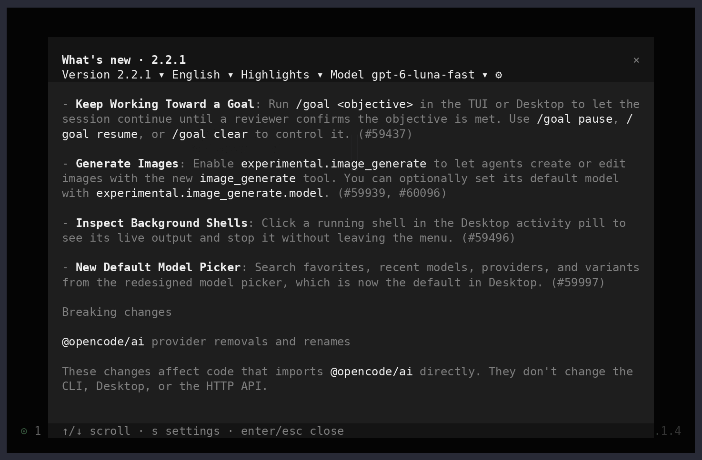

# OpenCode 2 Changelog


Read OpenCode release notes right in the terminal — in your language.
`/changelog` opens the latest release, translates it with a model of your choice and animates the switch.

**English → Русский**



**English → 中文**


## Features

- **Every OpenCode 2 release**, newest first; `/changelog 2.1.4` opens a specific one. Your installed version is marked.
- **Three views:** _Highlights_, _For me_ (highlights + up to five entries matching your interests), _All_.
- **Any language:** translation through any model OpenCode can reach; free `opencode/*-free` models never fall back to
  a paid one.
- **Offline-friendly:** notes and translations are cached; reopening costs nothing.
- **Animated:** a glitch wave while the model works and a decoding transition when the text arrives. Animations are
  swappable files — write your own.

## Requirements

- OpenCode **2.1.4 or newer** (TUI). See [docs/upstream-audit.md](docs/upstream-audit.md#minimum-opencode-version).
- Node.js 20+ to build; [Bun](https://bun.sh) to run the test.

## Install

```sh
git clone https://github.com/trin4ik/opencode2-changelog.git
cd opencode2-changelog
npm ci
npm run build
```

Register the plugin in `~/.config/opencode/cli.json` (the TUI config, not `opencode.jsonc`) and turn off OpenCode's
built-in highlights dialog, so that after an update this changelog opens instead. Run from the plugin folder; other
plugins and settings are kept:

```sh
cfg=~/.config/opencode/cli.json
[ -f "$cfg" ] || echo '{}' > "$cfg"
jq --arg p "$PWD" '.plugins = ((.plugins // []) - [$p] + [$p]) | .highlights = false' "$cfg" > "$cfg.tmp" &&
  mv "$cfg.tmp" "$cfg"
```

Or edit the file by hand — the result should contain:

```json
{
  "plugins": ["/absolute/path/to/opencode2-changelog"],
  "highlights": false
}
```

Restart the TUI and type `/changelog`. From now on, the first start after each OpenCode update opens it on the new
version. Keep `"highlights"` unset if you want both windows; set the plugin option `openOnUpdate: false` if you want
neither.

## Usage

| Key              | Action                                                                                |
| ---------------- | ------------------------------------------------------------------------------------- |
| `v`              | Version                                                                               |
| `l`              | Language (or _Other language…_ for any BCP 47 tag)                                    |
| `d`, `1` `2` `3` | View: Highlights / For me / All                                                       |
| `m`              | Translation model and variant (not your chat model)                                   |
| `s`              | Settings: prompt, languages, interests, animations, transition, original, cache reset |
| `c`              | Source: link, English original, PR list                                               |
| `r`              | Retry after an error                                                                  |
| `↑` `↓` / `Esc`  | Scroll / back or close                                                                |

A new translation sends the public release notes (and, in _For me_, your interests) to the selected provider and may
spend tokens. Switching language, view or version cancels the request in flight.

### Options

Optional defaults in `cli.json`; choices made in the window take precedence.

```json
{
  "plugins": [
    {
      "package": "/absolute/path/to/opencode2-changelog",
      "options": {
        "language": "de",
        "detail": "important",
        "model": { "providerID": "openai", "id": "gpt-6-luna-fast", "variant": "low" },
        "transition": "flap"
      }
    }
  ]
}
```

| Option            | Default                         | Meaning                                               |
| ----------------- | ------------------------------- | ----------------------------------------------------- |
| `language`        | `en`                            | Translation language (BCP 47 tag or name)             |
| `languages`       | `en zh es pt ru de ja fr ko uk` | Quick list in the language picker                     |
| `detail`          | `important`                     | `important` (Highlights), `personal` (For me), `full` |
| `model`           | `opencode/glm-5.3-flash-free`   | `{ providerID, id, variant? }`                        |
| `freeOnly`        | `true` for `*-free` models      | Never call a paid model                               |
| `interests`       | —                               | What matters to you, for _For me_                     |
| `prompt`          | built in                        | Translation prompt; `{language}` is substituted       |
| `selectionPrompt` | built in                        | Prompt for picking _For me_ entries                   |
| `transition`      | `decode`                        | `decode`, `flap` or `dissolve`                        |
| `animations`      | `true`                          | Turn all motion off                                   |
| `original`        | `false`                         | Show the English original                             |
| `openOnUpdate`    | `true`                          | Open once after OpenCode updates                      |

Free `opencode/*-free` models may answer `503` (“free tier can only be used from within OpenCode” or a usage limit)
through the public Generate API; the window then shows the original and offers another model.

## How it works

Release notes come from `CHANGELOG.md` on `dev`. Because `dev` can lag behind a fresh release, the newest `v2.x.y`
tag is checked, and missing versions are taken from that tag's `CHANGELOG.md` or its GitHub Release. Missing notes
are never invented: the window says which version it shows instead. Details and the reasoning behind each upstream
assumption: [docs/upstream-audit.md](docs/upstream-audit.md).

## Development

```sh
npm ci
npm run check         # TypeScript
npm run format:check  # Prettier
npm test              # packs, installs and exercises the plugin (Bun)
```

```
src/
  tui.tsx                 command in the `app` slot, notes loader
  changelog-service.ts    shared state: settings, caches, translator, model lists
  changelog-dialog.tsx    the window and its key layer
  changelog-reader.tsx    translation/selection requests and the animated viewport
  changelog-settings.tsx  settings panel and text editors
  changelog-model.ts      model picker on top of `ui.dialog.select`
  releases.ts translation.ts models.ts   pure logic
  motion/                 animation engine and swappable animations
```

### Write your own animation

Animations live in `src/motion/`. `engine.ts` captures the reader's cells, runs the timers and cleans up; an
animation only decides what to draw in a cell at a given moment.

1. Create `src/motion/transition-<name>.ts` exporting a `TransitionAnimation` (or a `LoadingAnimation`) from
   `kit.ts`.
2. Add it to the list in `src/motion/index.ts`.
3. Pick it in the window: `s` → `t`. `s` → `x` resets the caches so you can watch the loading again.

```ts
export const typewriter: TransitionAnimation = {
  id: "typewriter",
  title: "Typewriter",
  duration: () => 0, // each cell simply appears at its random start
  enter() {},
  leave: leaveDimmed,
}
```

## Contributing

**Issues.** Include `opencode --version`, your terminal, the view and language, what you expected and what happened.
A screenshot or a short recording helps a lot with anything visual.

**Pull requests.** Keep them small and focused. Run `npm run check`, `npm run format:check` and `npm test`, and say in
the description how you verified the change — for visual changes, in a real OpenCode TUI. Read
[AGENTS.md](AGENTS.md) first: it lists the rules this plugin keeps (public API only, no background polling, cancelled
requests, the single smoke test).

## License

[MIT](LICENSE)
